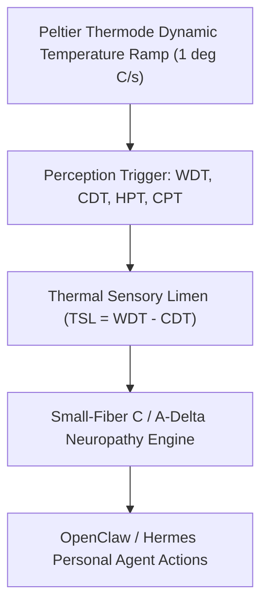

# Quantitative Sensory Testing (QST) Thermal Threshold Skill

[](LICENSE)
[](https://www.python.org/)
[](requirements.txt)
[](mcp_server.py)
[](SKILL.md)

Zero-dependency sovereign personal agent skill for non-invasive evaluation of Quantitative Sensory Testing (QST) thermal thresholds, Thermal Sensory Limen (TSL), and small-fiber neuropathy.



## Features
- **Deterministic Math**: Pure Python standard library implementation with zero external dependencies.
- **German Neurological QST Standards (DFNS)**: Implements validated equations for thermal sensory limen and pain thresholds.
- **Small-Fiber Neuropathy & Allodynia Screening**: Sensitive detection of intraepidermal nerve fiber density decline.
- **Model Context Protocol (MCP)**: Native JSON-RPC tool integration for LLMs and autonomous agents.

## Quickstart

```python
from client import CutaneousThermalQSTClient

client = CutaneousThermalQSTClient()
result = client.evaluate_thermal_thresholds(
    warm_detection_temp_c=35.4,
    cold_detection_temp_c=29.6
)
print("Thermal Sensory Limen:", result["thermal_sensory_limen_tsl_deg_c"], "deg C")
print("Classification:", result["classification"])
```

## License
Apache-2.0
